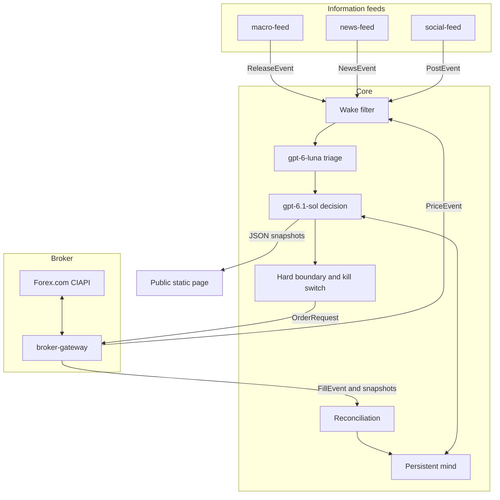

# PipMind

An autonomous AI forex trader that reads economic data, news and social posts 24/5, writes and evolves its own trading rules, and publishes every trade, its P&L and its reasoning live.

**Status: hosted M4 shadow foundation.** The replay/evaluation foundation, dry broker gateway, information feeds and SQL-backed shadow runtime are implemented. The approved private backend runs alongside the preserved public landing, with initial real Foundry/feed/journal/clone flows verified. Complete provider/broker coverage, model quality, capacity/cost and a full live shadow day remain qualification gates. No order submission or track record exists. See [the shadow guide](docs/shadow.md), including [continuing memory and Markdown knowledge](docs/shadow.md#markdown-knowledge-and-continuing-memory).

PipMind is a public portfolio project by [Henrique Meyer](https://github.com/henrique-meyer), a senior software engineer and architect at Nitrosoft Technology Inc. It will run on one Forex.com account (StoneX / GAIN Capital, via CIAPI) and keep a public page of what it did and why.

## Why this is interesting

The model is the trader. Deterministic code does not encode a strategy. The model reads the macro prints, the headlines, the posts and the prices, then chooses to enter, add, exit or hold, and writes down its reason.

It is also one continuous trader, not a fresh prompt on every tick. A persistent mind holds its identity, a playbook of rules it wrote itself, its current views, and a journal. The planned **Auto Learn** control enables autonomous nightly learning from the day's activity; the owner can turn it off to preserve the robot's exact learned rules and guides while current market/account observations and decisions continue. When enabled, review adds, sharpens or retires rules and the diff is public. The review/control implementation remains M7 work.

A reusable [blank trader template](templates/blank/README.md) starts with standing constraints and no inherited strategy or experience. The design includes [private owner chat](docs/architecture.md#private-owner-chat-and-confirmed-edits) for questions, suggestions and confirmed direct Markdown edits. Chat is an additional influence; nightly review and all other learning from trades, experience and market events remain autonomous under their existing rules. The UI and durable chat-edit enforcement remain planned; starter files work with existing paused SQL initialization.

The [robot library and save design](docs/architecture.md#robot-library-and-active-working-copy) adds multiple imported saves, protected favorites, **Save a copy**, expiring rolling autosaves and one unnamed **Active robot** working copy. Load a blank or saved starting point without changing its source library item. [Robot and account are separate](docs/architecture.md#robot-and-account-separation): replace the active copy even with positions open through a safe handover. Load restores saved rules/guides/lessons, including their active retrieval state, without rewinding account trades, positions, balances or risk state. These controls remain planned, distinct from the existing full-experience export below; external imports and future robot sharing use the same validated robot-only format.

The design includes [portable Markdown mind bundles](docs/architecture.md#markdown-mind-export-and-import): a ZIP-based `.pipmind` file can clone its saved experience into a new trader or, with matching operational state and broker reconciliation, recover the original trader. This preserves the saved mind, without promising identical future trades. M4 implements consistent SQL-backed experience export and paused atomic clone import; original-trader operational recovery remains M5 work.

Losses stay on the page next to the reasoning that produced them. The project makes no claim about returns.

Vendors and the broker sit behind small services with fixed messages. Replacing a data provider, or replacing the broker, does not rewrite the core.

## How it works

Four services sit around one core. Three of them only emit events. The fourth, `broker-gateway`, is the only process that speaks to the broker: it streams prices out and accepts orders in, and it contains no trading logic.



On each wake, a cheap model (`gpt-6-luna`) triages and summarizes. A strong model (`gpt-6.1-sol` on Microsoft Foundry) makes the decision. Code enforces an outer size and loss boundary, a daily-loss stop and a kill switch. The broker's snapshots are the source of truth for positions and balances.

The public page is a static site built from JSON snapshots. Visitors do not call the model or the broker; static hosting and Blob traffic remain subject to their quotas and usage charges. The page shows this account's own fills, its P&L, the reasoning for each decision, and playbook diffs. Broker quotes and other market data stay inside the trading system. That split is a design choice: the page is a record of what this account did, and it is not a market-data display. X is a read-only input; PipMind does not publish posts or request X write permissions.

## Design docs

For a visual walkthrough, start with the [infrastructure diagrams](docs/infrastructure-diagrams.md)
and [workflow diagrams](docs/workflow-diagrams.md). They distinguish the recorded
shadow deployment from newer dry implementations and planned capabilities, using
generic labels instead of instance resource names.

| Doc | What it covers |
| --- | --- |
| [Architecture](docs/architecture.md) | Services, event contracts, the mind, learning, limits, failure handling, deployment |
| [Cost model](docs/cost-model.md) | Demo estimate of $151–160/month, $180 planning budget, assumptions, and production cost options |
| [Data sources](docs/data-sources.md) | Feeds, why each one is there, and the role-based social list |
| [Roadmap](docs/roadmap.md) | Milestones M0–M8, from this design to a public launch |
| [Landing deployment](infra/README.md) | Local container, CI, GHCR, Azure delivery and custom-domain handoff |
| [Information feeds](docs/feeds.md) | M3 macro/news/social workers, durable input state, read-only policy and offline validation |
| [Shadow runtime](docs/shadow.md) | M4 SQL mind, Foundry adapter, private engine/feed container, clone operations and pending hosted/live gates |
| [Dry broker gateway](docs/gateway.md) | M2 sessions, streaming/fallback, durable dry commands, internal service and offline validation |
| [ADRs](docs/adr/0001-ai-makes-the-decisions.md) | Why the model decides, why the services are swappable, where macro data comes from, why the mind persists, and how suggestions differ from overrides |

## Run the offline replay

From the repository root with Python 3.12 and `uv`:

```sh
uv sync --locked --all-extras
uv run python -m pipmind.replay validate
uv run --all-extras python -m pytest -q
uv run python -m pipmind.replay run --ci
```

The 30-case dataset currently has 14 passing cases and 16 explicit later-capability deferrals. The fixture week emits 15 scripted decisions, five unsent proposals and zero dispatches. M2 adds 15 mandatory gateway checks; M3 adds 14 feed checks and actual worker/container kill-and-restart checks. M4 separately requires real SQL integration, twelve starter scenarios through the shadow engine, eight SQL replay gates and container/database restart checks. Generated decisions, full traces and reports stay ignored; CI uploads bounded synthetic summaries only. No provider credentials or external calls are needed after dependency installation. See [the replay/evaluation guide](docs/replay.md) and [SQL shadow checks](docs/shadow.md#local-sql-and-mandatory-checks).

## Stack

Python 3.12, the Microsoft Agent Framework, Microsoft Foundry, Azure SQL, Docker, GitHub Actions. The hosted demo uses one always-on Azure Container App with engine/feed and broker-gateway containers, default networking, SQL S0, Blob snapshots, and Azure Static Web Apps Free. Hosting is estimated at $59/month and the full system at $151–160/month, with an $180 planning budget and spend alerts rather than silent cutoffs. Tax and a possible provider display add-on are additional. Details are in the [cost model](docs/cost-model.md).

AI integration uses a Foundry resource/project and the Agent Framework Foundry connector. The agent loop and SQL-backed mind run in Container Apps. Foundry model availability, quota and deployment prices must be verified before provisioning; see [Foundry model access](docs/architecture.md#microsoft-foundry-model-access). The current landing page has no AI integration yet.

The application remains suitable for separately configured production deployments with independent apps/identities, stronger networking, larger resources, and enhanced recovery/monitoring at a higher cost. Production hosting does not authorize a live broker account; the rollout still starts with replay, shadow mode, and demo orders. See [deployment profiles](docs/architecture.md#deployment).

## Disclaimer

PipMind is a public experiment by Henrique Meyer. It is not investment advice and it is not a signal service. It will not offer copy-trading, a paid tier or affiliate links. The same page is shown to everyone. Forex trading can lose money. When a track record exists, it will include the losses.

## License

[GNU Affero General Public License v3.0](LICENSE).

## Author

Henrique Meyer, Nitrosoft Technology Inc.
