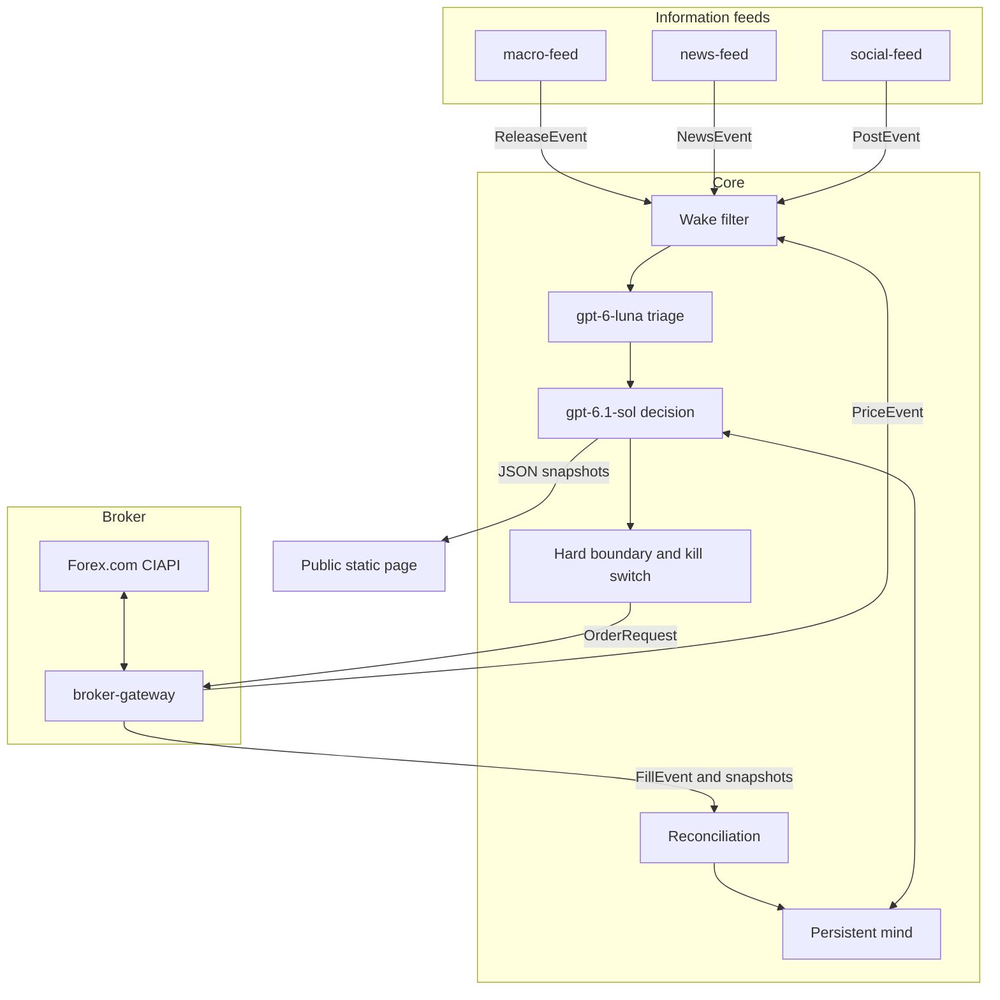

# PipMind

An autonomous AI forex trader that reads economic data, news and social posts 24/5, writes and evolves its own trading rules, and publishes every trade, its P&L and its reasoning live.

**Status: in design.** Nothing here is trading yet. There is no track record to show.

PipMind is a public portfolio project by [Henrique Meyer](https://github.com/henrique-meyer), a senior software engineer and architect at Nitrosoft Technology Inc. It will run on one Forex.com account (StoneX / GAIN Capital, via CIAPI) and keep a public page of what it did and why.

## Why this is interesting

The model is the trader. Deterministic code does not encode a strategy. The model reads the macro prints, the headlines, the posts and the prices, then chooses to enter, add, exit or hold, and writes down its reason.

It is also one continuous trader, not a fresh prompt on every tick. A persistent mind holds its identity, a playbook of rules it wrote itself, its current views, and a journal. A nightly review adds, sharpens or retires those rules, and the diff is public.

Losses stay on the page next to the reasoning that produced them. The project makes no claim about returns.

Vendors and the broker sit behind small services with fixed messages. Replacing a data provider, or replacing the broker, does not rewrite the core.

## How it works

Four services sit around one core. Three of them only emit events. The fourth, `broker-gateway`, is the only process that speaks to the broker: it streams prices out and accepts orders in, and it contains no trading logic.

On each wake, a cheap model (`gpt-6-luna`) triages and summarizes. A strong model (`gpt-6.1-sol` on Azure OpenAI) makes the decision. Code enforces an outer size and loss boundary, a daily-loss stop and a kill switch. The broker's snapshots are the source of truth for positions and balances.

The public page is a static site built from JSON snapshots. Visitors do not call the model or the broker, so a crowd adds no cost. The page shows this account's own fills, its P&L, the reasoning for each decision, and playbook diffs. Broker quotes and other market data stay inside the trading system. That split is a design choice: the page is a record of what this account did, and it is not a market-data display.

## Design docs

| Doc | What it covers |
| --- | --- |
| [Architecture](docs/architecture.md) | Services, event contracts, the mind, learning, limits, failure handling, deployment |
| [Cost model](docs/cost-model.md) | Budget under $100 a month, and the assumptions behind it |
| [Data sources](docs/data-sources.md) | Feeds, why each one is there, and the role-based social list |
| [Roadmap](docs/roadmap.md) | Milestones M0–M8, from this design to a public launch |
| [ADRs](docs/adr/0001-ai-makes-the-decisions.md) | Why the model decides, why the services are swappable, where macro data comes from, why the mind persists, and how suggestions differ from overrides |

## Stack

Python 3.12, the Microsoft Agent Framework, Azure OpenAI, SQLite, Docker, GitHub Actions. The production target is a small always-on Azure host. The monthly budget target is under $100, with spend alerts rather than silent cutoffs. Details are in the [cost model](docs/cost-model.md).

## Disclaimer

PipMind is a public experiment by Henrique Meyer. It is not investment advice and it is not a signal service. It will not offer copy-trading, a paid tier or affiliate links. The same page is shown to everyone. Forex trading can lose money. When a track record exists, it will include the losses.

## License

[GNU Affero General Public License v3.0](LICENSE).

## Author

Henrique Meyer, Nitrosoft Technology Inc.
