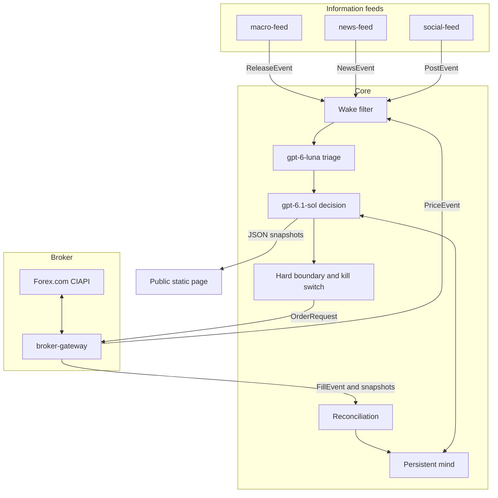
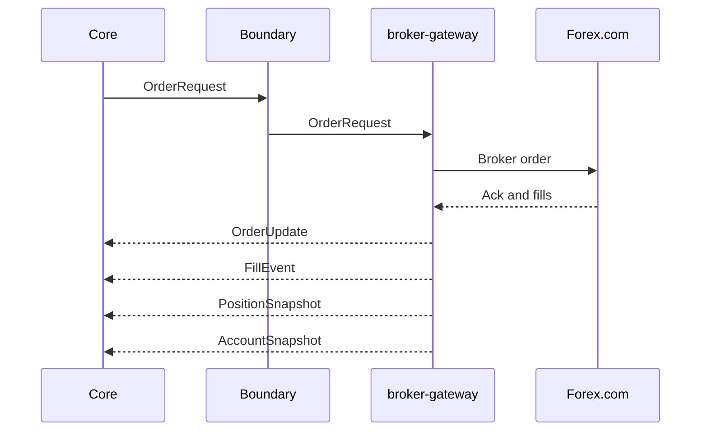

# Architecture

PipMind is four logical services around one core. The core is the trader. The services are replaceable. The hosted demo groups these components into two containers in one Azure Container App; their contracts also support separate production deployments.

**Implementation checkpoint (M4):** the [shadow runtime](shadow.md) supplies the SQL-backed mind/retrieval, durable feed delivery, project-backed Agent Framework Foundry adapter and atomic paused experience clones. PIP-13 deployed the approved private always-on SQL/Foundry/backend alongside the preserved public landing and verified initial real model/feed/journal/clone flows. It cannot send orders. PIP-15 compacts model context; complete provider/broker coverage, full-day capacity/cost/evaluations and retained-day export remain PIP-14 qualification gates. M5 safety/recovery, M6 demo execution and M7 review are not implemented by shadow.

The current public landing page supports optional runtime-configured GA4 analytics, disabled when no measurement ID is supplied. Analytics runs in the visitor's browser, separately from feed, broker, model and trader telemetry. Configuration and collection controls are described in the [landing deployment guide](../infra/README.md#google-analytics); enabling it on the hosted instance requires the deployment's own configuration and approval.

Landing search metadata is server-rendered from a validated public origin supplied privately at runtime, with canonical/social URLs, WebSite structured data and a public-page sitemap. Unconfigured previews are noindex; operational/private routes are never public content. See [search metadata and discovery](../infra/README.md#search-metadata-and-discovery). This does not establish Search Console ownership, indexing or a ranking result.

| Service | Talks to | Emits | Accepts |
| --- | --- | --- | --- |
| `macro-feed` | FXMacroData, ForexFactory | `ReleaseEvent` | — |
| `news-feed` | Public RSS, plus headlines relayed by the gateway | `NewsEvent` | `HeadlineRelay` |
| `social-feed` | X, official pages for role lookups | `PostEvent` | — |
| `broker-gateway` | One broker. The first implementation is Forex.com (StoneX / GAIN Capital CIAPI) | `PriceEvent`, `OrderUpdate`, `FillEvent`, `PositionSnapshot`, `AccountSnapshot` | `OrderRequest` |

Decisions, sizing, the playbook, the outer safety boundary and reconciliation policy live in the core. The gateway has no trading logic. Swapping a data vendor or the broker means replacing one service and keeping these messages. See [ADR 0002](adr/0002-swappable-services.md).



Messages are JSON with UTC timestamps and `schema_version`. The checked-in [v1 JSON Schemas](../contracts/README.md) are the source of truth; Python validation also checks cross-field chronology and evidence relationships. The links below reference those contracts rather than maintaining duplicate sketches.

The core is a single Python 3.12 process built on the Microsoft Agent Framework. Model calls go to Microsoft Foundry. The hosted demo stores durable state in Azure SQL Database Standard S0. Local development uses a SQL Server container for database integration checks; a SQLite adapter may support isolated replay fixtures, but is not the hosted state or lease store.

## macro-feed

M3 implements the [information feed runtime](feeds.md), with independently supervised macro/news/social processes, durable development inbox/cursors and offline provider fixtures. M4 adds the SQL inbox/outbox adapter, canonical page capture/reprocessing and durable shadow consumption. Feeds can run inside the shadow engine container or through the authenticated standalone handoff API. Vendor polling remains opt-in; hosted ingress, live provider coverage and actual Azure operation require qualification.

Emits one `ReleaseEvent` per release. The core never calls a macro vendor.

- **Actuals.** FXMacroData over server-sent events is primary. Reconnect uses `Last-Event-ID` so a dropped connection replays what was missed. A signed webhook (HMAC, vendor retries) is the backup. SSE and webhook deliveries of the same print collapse to one `event_id`.
- **Schedule, consensus, PMIs.** ForexFactory's weekly calendar file, cached and refreshed about once an hour. That file has no actual. It does have forecast, previous and impact, and it is how PMIs get onto the calendar. FXMacroData does not cover PMIs and does not publish a true consensus.
- **`forecast` means consensus.** ForexFactory wins. An FXMacroData captured forecast is copied in only when ForexFactory has no number.

A PMI print that never arrives as a `ReleaseEvent` can still arrive as a headline. `news-feed` does not invent a `ReleaseEvent` from that headline. A later actuals adapter, if one is added, lives inside `macro-feed`.

Details, license and the hourly ForexFactory limit are in [Data sources](data-sources.md) and [ADR 0003](adr/0003-macro-data-sources.md).

### ReleaseEvent

Versioned contract: [ReleaseEvent](../contracts/v1/release-event.schema.json).

## news-feed

Emits `NewsEvent`. Starting sources are free RSS feeds: investinglive, BabyPips, MarketWatch, CNBC, Google News, and central-bank press feeds. Broker Reuters headlines arrive as `HeadlineRelay` from `broker-gateway`, which is the only CIAPI client. The feed never logs in to the broker itself.

Two kinds of item:

- **Breaking.** A new fact: a print, a decision, an official statement, a wire headline. These may wake the core.
- **Analysis.** Commentary, education, recaps, outlooks. Stored and included in the daily brief and the nightly review. They do not wake a trading decision on their own.

The adapter sets `kind` from the source section. The cheap model may correct it. Analysis feeds are not a back door into the intraday loop.

Paywalls stay closed. When a feed provides a headline and a link, that is the whole item. The body is stored only when the feed itself included it and the terms allow keeping it. Google News is used as discovery: headline and outbound link.

Wire text is an input to the model. The public page publishes the model's reasoning, not a republication of the wire.

### NewsEvent

Versioned contract: [NewsEvent](../contracts/v1/news-event.schema.json).

### HeadlineRelay

Internal message from the gateway to `news-feed`. It is broker text in transit, not a trading signal and not a public document.

Versioned contract: [HeadlineRelay](../contracts/v1/headline-relay.schema.json).

## social-feed

Emits `PostEvent`. The follow list is a set of **roles** (Fed chair, BoJ governor, Japan's finance minister), not a set of people. A weekly job, run while the FX week is closed, re-reads an official page for each role and compares the holder. A changed holder stops polling of the old personal account; institutional accounts stay. A lookup that fails to parse is a failure and alerts the owner. It is never treated as "no change".

X access is **read-only**: read selected accounts' posts and perform necessary account/role lookups. PipMind does not publish posts, reply, repost, like, follow, send messages, or request write permissions. The public record is published to PipMind's website, not to X.

X is pay-per-use. The account list is trimmed so the expected bill stays in the budget band. Spend raises an alert. The feed does not drop posts from the selected accounts to enforce a dollar cutoff. Credit exhaustion or provider-side limits can still interrupt access; monitor the balance and alert before that happens. The design of the list, the weekly job and a trimmed example are in [Data sources](data-sources.md).

### PostEvent

Versioned contract: [PostEvent](../contracts/v1/post-event.schema.json).

## broker-gateway

M2 now implements the [dry gateway](gateway.md): an authenticated internal service/container, opt-in read-only CIAPI/Lightstreamer adapters and a local dry command ledger. The synthetic recorded session runs offline in CI. No order-submission method exists, no real broker session is verified, and the deployed landing is unchanged. SQLite is isolated dry development/replay storage; Azure SQL ledger/ownership integration remains M5. See the guide for the mandatory dry acknowledgement envelope, fallback limits and broker verification prerequisites.

One process, one broker, one account. The Forex.com implementation speaks CIAPI Trading API v2 (v1 session and market calls are on the way out), streams prices over Lightstreamer, and falls back to REST. It is the only place that holds broker credentials, and those credentials come from the environment, never from the repo.

The gateway does not decide to trade, size a position, or interpret news. It does:

- keep the session alive, re-login when the broker says the session is gone, and reconnect the stream
- map a core instrument id (`EUR/USD`) to the broker's market id, and reject an instrument it cannot map
- emit `PriceEvent`
- accept `OrderRequest` and emit `OrderUpdate` and `FillEvent`
- emit `PositionSnapshot` and `AccountSnapshot` on a timer and after fills
- respect broker rate limits with backoff
- treat `client_order_id` as an idempotency key

A previous private prototype showed three broker-side failures worth designing for directly. The price stream can go quiet without a server error, so a stale-stream watchdog marks the feed unhealthy and REST covers prices until the stream is fresh again. An expired session shows up as an authentication failure, so the next call logs in again and retries. A restart can overlap the old process, so the core holds a lease and the gateway refuses a repeated `client_order_id`.

The gateway may coalesce quotes for transport. Venue timestamps are preserved. Coalescing is not a trading filter. A stream that has produced nothing inside the watchdog window is stale: the gateway sets `stale: true`, resubscribes, and serves REST quotes until venue timestamps are fresh. The watchdog interval is configuration per instrument.

Size is a positive decimal in the unit the instrument map declares. If the broker cannot represent that size, the gateway rejects the request and reports the reason. It does not round up, and it does not invent a smaller order. Sizing belongs to the core.



### PriceEvent

Internal. Never copied to the public site.

Versioned contract: [PriceEvent](../contracts/v1/price-event.schema.json).

### OrderRequest

Core to gateway. `client_order_id` is unique per command and is the idempotency key. A retry of the same command reuses it. A modify or a close is a new command with its own id, and points at the earlier command with `related_client_order_id` when it is targeting a working order.

Versioned contract: [OrderRequest](../contracts/v1/order-request.schema.json).

### OrderUpdate

Versioned contract: [OrderUpdate](../contracts/v1/order-update.schema.json).

A full fill emits an `OrderUpdate` with `status: filled` and one or more `FillEvent`s. A partial fill emits `status: partial` and a `FillEvent` per execution.

### FillEvent

The fill price is this account's execution. It may appear on the public page as a fill. It is not a quote.

Versioned contract: [FillEvent](../contracts/v1/fill-event.schema.json).

### PositionSnapshot

Versioned contract: [PositionSnapshot](../contracts/v1/position-snapshot.schema.json).

### AccountSnapshot

Internal. Used for reconciliation and the daily-loss stop. The public page does not dump this object.

Versioned contract: [AccountSnapshot](../contracts/v1/account-snapshot.schema.json).

## Core loop

1. **Ingest.** Append `ReleaseEvent`, `NewsEvent`, `PostEvent` and `PriceEvent` to the event log. Price ticks are aggregated into a short state (last quote, session range, a move worth mentioning). Macro, news and social items are not discarded to save tokens.
2. **Wake.** The filter decides that the strong model might have something to do. Wakes include a release, a breaking headline, a post from a followed role, an aggregated price move, a fill, a snapshot that disagrees with the core, and the clock (a daily brief, the nightly review, session open and close). Analysis items wait for the brief. There is no keyword list. A previous private prototype used one, and it missed headlines.
3. **Triage.** `gpt-6-luna` summarizes the new material and says whether `gpt-6.1-sol` should be called. Every ingested macro, news and social item is visible to this model. Triage is allowed to say "do not wake". It is not allowed to drop the item from the journal of what was seen.
4. **Decide.** `gpt-6.1-sol` reads the mind and the triage summary and returns `enter`, `add`, `exit` or `hold`, plus written reasoning and the limits it wants for this regime. See [ADR 0001](adr/0001-ai-makes-the-decisions.md).
5. **Remember.** Working memory and the journal update after every decision, including holds that matter.
6. **Bound.** The hard boundary accepts or refuses the order. A refusal is written back into the journal so the model sees it on the next call.
7. **Send.** Only a boundary-approved `OrderRequest` goes to the gateway, and only while the lease is held and snapshots are fresh.
8. **Reconcile.** Snapshots overwrite the core's view of positions, balance, margin and fill state. Then working memory is corrected if its thesis referred to a position that is gone.

If the strong model errors, or triage cannot run, the core does not open new risk. Existing broker-side orders are left in place unless an override says to flatten. The owner is alerted.

The decision step is an agent in the Microsoft Agent Framework. Its tools read the mind, search long-term memory, record the decision, and propose an order. Proposing an order hands the request to the boundary. The agent has no tool that talks to the broker.

### Microsoft Foundry model access

Microsoft Foundry is the AI platform. Plan a Foundry resource and project with configurable deployments for the triage, decision/review and optional evaluation-judge roles. The selected model families remain `gpt-6-luna` and `gpt-6.1-sol`; availability, API capabilities, quota and regional pricing must be verified before provisioning. Deployment names are configuration, not hard-coded model identifiers.

Use the Python Agent Framework Foundry connector (`agent-framework-foundry`, `FoundryChatClient`) for project-backed inference. The project endpoint and deployment names belong in private configuration. Use explicit managed-identity credentials in the hosted engine with narrowly scoped Foundry permissions; use the established local Azure identity for approved developer runs. The engine owns instructions, tool execution, sessions and the SQL-backed mind in Container Apps. Foundry-managed memory and hosted agent runtimes are separate capabilities to assess only if subsequently needed.

Foundry resource/project provisioning, deployment selection, identity access and an inference smoke check belong to M4 after resource approval. Optional model-judged evaluations use the configured Foundry project and grader deployment. The landing bootstrap has no model connector or AI resource, and credential-free replay CI continues to use fakes.

Implementation references: [Microsoft Foundry model provider](https://learn.microsoft.com/en-us/agent-framework/integrations/by-component/model-providers/microsoft-foundry) and [Foundry SDKs and endpoints](https://learn.microsoft.com/en-us/azure/foundry/how-to/develop/sdk-overview).

### Decision record

Stored in the journal and, when it is a real action or a material hold, reflected on the public page.

Versioned contract: [DecisionRecord](../contracts/v1/decision-record.schema.json).

## Persistent mind

The mind is read on every model call and updated after every decision. [ADR 0004](adr/0004-persistent-mind.md) records why. The five parts:

| Part | Contents | In the cached prefix? |
| --- | --- | --- |
| Identity | Who it is, the mandate, constraints it must not rewrite | Yes |
| Playbook | Self-written rules, with version | Yes, until the nightly review cuts a new version |
| Working memory | Views, open-position theses, what it is waiting for | No. It changes after each decision |
| Recent journal | Latest decisions, fills, refusals, surprises | No. A short tail is appended |
| Long-term memory | Older journal, reviews, suggestion outcomes | No. Retrieved passages only |

Identity and the playbook are placed first and kept byte-stable between playbook versions to benefit from prompt caching. Everything that changed since the last call comes after. The demo's base model allowance does not depend on achieving a particular cache hit rate.

Hosted long-term memory starts with Azure SQL full-text search. Store access and retrieval sit behind adapters so replacing the index or changing deployment capacity does not change the five-part shape. A local replay adapter is not evidence that Azure SQL transactions, search, or concurrency have been validated; database integration checks must exercise the SQL Server adapter.

The mind is operational data. It is not committed into this source repository.

Model context and audit retention are separate. [Phase-specific views](shadow.md#processing-and-persistence) keep triage compact and supply decisions with bounded current market views, all confirmed position theses and active prerequisites plus selected source evidence. Retrieval can reach older material events and opposing evidence; age alone does not invalidate a view. Structured journal projections prevent previous prompts from being recursively copied forward. Full original events and model-visible traces remain in SQL. The [Markdown knowledge discussion](shadow.md#markdown-knowledge-and-continuing-memory) describes how readable standing policy and durable briefs fit this persistent mind without treating a file repository as free model memory.

### Markdown mind export and import

The existing **experience** profile below is a full retained-mind/audit export, not the lightweight robot definition now requested. The planned [compact robot saves](#compact-robot-saves-and-restore) preserve rules/guides separately from account history; existing experience/recovery files must not be silently reinterpreted as that new profile. Current runtime schemas/commands do not yet implement compact saves, manual save/restore or account-to-robot reassignment.

PipMind supports a portable saved mind: another environment can import the same identity, playbook and retained experience at an identified checkpoint. This preserves saved state, not the underlying model weights or identical future decisions. Model availability, application behavior, retrieved context, new events and account conditions can change subsequent decisions. Learning here updates durable experience and playbook data; it does not fine-tune the model. M1 supplies the versioned contracts and synthetic validation fixtures. M4 implements [SQL-backed consistent export and paused experience-clone import](shadow.md#experience-bundles-and-cloning), with explicit bounded runtime format and actual SQL rollback tests. Original-trader operational recovery remains M5 work; contract validation alone never activates a mind.

SQL remains the transactional runtime store. Export/import is an explicit owner operation over that store, rather than live editing a directory of Markdown files. All durable context used by the agent must be exportable; provider-side conversation/session IDs cannot be the sole copy of memory.

#### Bundle format

A `.pipmind` file is a standard ZIP archive with a PipMind manifest at its root. Both export kinds use this extension; `manifest.json` declares `experience` or `recovery`. The custom extension identifies the artifact for users, while the importer validates the actual container, format and version. A representative layout is:

```text
saved-mind.pipmind
  manifest.json
  mind/
    identity.md
    playbook.md
    working-memory.md
    journal/
    reviews/
    memories/
    playbook-history/
  recovery/                 # recovery kind only
    state.json              # versioned operational sidecar
```

The Markdown files contain all five mind parts and the complete retained archive, not only summaries or passages previously retrieved. Versioned front matter carries stable record/rule IDs, timestamps, provenance, evidence links, suggestion dispositions and override tags. Preserve identity/playbook text bytes, rule status (including retired rules), review history and chronology. Declare retention bounds and any known gaps; an incomplete export must not be advertised as a complete saved mind. Derived search indexes can be rebuilt from the preserved records.

The manifest contains the format and schema versions, export kind, logical trader/lineage and export IDs, UTC creation time, checkpoint/event watermarks, archive coverage, file inventory with SHA-256 checksums, and application, prompt, retrieval, model-version and inference-setting metadata needed to assess compatibility. Use logical configuration references, not credentials, private endpoints or actual cloud deployment identifiers. Record unavailable version metadata explicitly; a different model/runtime requires a visible compatibility decision and cannot imply equivalent future behavior. Checksums detect corruption; they do not authenticate who created the bundle. Use authenticated owner access and trusted private transfer/storage.

Recovery adds structured durable operational state tied to the same checkpoint: command and deduplication ledgers, pending/ambiguous dispatches, broker identifiers and known outcomes, event/reconciliation watermarks, account-state references, and active stops/overrides. This private sidecar complements the human-readable mind; Markdown alone cannot reconstruct safe order execution. The bundle excludes secrets, credentials, cloud resource configuration and reusable lease authority. Broker/account binding is verified against private destination configuration, not trusted from narrative text.

#### Import modes

| Mode | Preserved experience | Destination behavior |
| --- | --- | --- |
| **Clone experience** | Identity, current and historical playbooks, journal, reviews, suggestions and long-term memories, with source provenance. Preserve working views and position theses as dated source context. | Create a new trader lineage linked to the source checkpoint. Archive source position theses as historical, initialize active account/position state from the destination, and refresh time-sensitive views before new decisions. Do not activate source positions, pending commands, account permissions, leases, overrides or numerical risk limits. Destination owner configuration supplies its limits and access. |
| **Recover original trader** | The complete saved mind and matching operational sidecar, retaining original trader identity and historical IDs. | Restore into an inactive destination for the same privately configured broker account/environment. Preserve command IDs, known outcomes and stop/override restrictions; acquire fresh fenced ownership, reconcile fresh positions, balances, orders and fills, and resolve ambiguous commands before explicit owner resumption. |

A clone deliberately separates inherited knowledge from account authority. The import report identifies these transformations rather than claiming byte-identical active working state. Historical source fills and P&L remain attributed to the source lineage and never become the destination account's execution history or track record. Override tags remain excluded from learning even when the active override itself is not cloned. Destination immutable identity constraints and code-enforced boundaries still apply; incompatible identity/policy content is rejected rather than silently rewritten.

Recovery cannot bring the original lease back to life or reset a daily-loss stop. Verify the original owner is drained or fenced out; invalidate old ownership generations using the recovery protocol even if the SQL store was restored. Reconcile events and broker activity since the checkpoint, including possible orders accepted after export. Never automatically resend a pending command because the snapshot predates its result. Missing operational records, an account/environment mismatch, stale snapshots or unresolved outcomes keep dispatch disabled. Active restrictive overrides survive recovery until their established expiry or explicit owner action, under the existing override policy.

#### Consistency and validation

Export from a consistent database checkpoint covering mind, rule versions and referenced history; recovery includes operational state at that same boundary. Coordinate writers or use a transactionally consistent snapshot, then capture subsequent durable events for recovery catch-up. Record the boundary and finish the archive before making it available. Export does not halt the source by itself; recovery is a separate controlled handover. Keep database backups and durable event records: a mind bundle is not a replacement for operational disaster recovery.

Import first validates the manifest/schema, every inventoried file/hash, record relationships, coverage and supported versions in isolation. Reject unknown/missing files, duplicate entries/IDs, broken evidence links, incompatible schemas and partial or corrupt bundles. Apply bounded archive entry counts, decompressed sizes and compression ratios; reject absolute/traversal paths, links and any entry escaping staging. Parsing Markdown/front matter must not execute code, fetch URLs or treat imported narrative as permission to call tools. Define supported migrations explicitly and retain the source artifact; never silently discard fields.

Stage the complete import and rebuilt retrieval index before an atomic activation into an empty/inactive destination store. Failed validation, interruption or migration leaves existing active state unchanged; merging into a running mind is outside this contract. Import itself makes no model calls or order submissions, and both modes start paused. A clone enters replay/shadow validation before separately authorized trading; recovery requires the ownership/reconciliation gates above and an authenticated resume action. Imports grant neither live-account authorization nor permission to provision resources.

Real `.pipmind` bundles and extracted contents are private operational data, stored under ignored private data/output paths, excluded from Git and container images, and kept out of public snapshots, logs and CI artifacts. Compression provides no confidentiality; use protected storage/transport and any separately configured encryption outside the base ZIP format. Public playbook diffs are a separate sanitized publication. Only synthetic fixtures may be tracked, without a blanket ignore exception for real exports.

Verification must compare exported/imported retained records, exact identity/playbook text, versions, IDs, chronology, provenance and override exclusions. Exercise clone account separation and explicit transformations, recovery with late/ambiguous orders and stale owners, and invalid/interrupted import with no active-store mutation. SQL transaction, ownership and recovery checks use the actual SQL Server adapter; fake traces alone cannot certify them. The [roadmap](roadmap.md) and [portability delivery plan](plan.md#mind-portability-delivery-requirements) assign these checks to M1/M4/M5/M6/M7 without changing rollout order.

### Robot and account separation

The account is the trading desk; a robot is the trader assigned to it. Replacing the trader changes training, experience and decision-making, not the account or its existing trades. This is the planned domain boundary:

| Entity | Owns |
| --- | --- |
| Robot | Identity, playbook/decision rules, guides, distilled learned lessons, lineage and robot versions |
| Account | Broker binding, orders/fills/trade history, positions, balances, margin, account-level risk limits/counters/stops and execution/reconciliation state |
| Assignment | Which active working-copy generation manages which account, lifecycle and authorized load/handover history; no permanent user-visible named robot binding is required |
| Decision audit | Original account and robot/version/assignment, evidence available at the time, rationale, proposals/refusals and confirmed outcomes |

Runtime reasoning combines the assigned robot's own mind with authorized current market/account facts. Account history and the original rationale for an inherited position remain available as evidence; they do not become the replacement's learned strategy or training. The replacement receives current feeds, positions/orders, protective-order state and applicable account constraints, and may reassess positions using its own policy. It does not inherit the former robot's working beliefs as mandatory rules. New account-scoped working context is derived/reconciled from current facts, with historical claims dated and attributed. A compact robot package contains no account trade history, open positions or operational authority.

The owner may replace an account's robot at any time, including with open positions; there is no requirement to flatten first. This is a controlled handover, not two simultaneous decision owners. Confirm the target account, robot/save version and expected assignment generation; stop/fence the old runtime, resolve pending or ambiguous execution, reconcile the account, validate the replacement against current position obligations, then atomically activate a new assignment generation. Refuse stale old-robot outputs and orders. Preserve existing protective orders and account restrictions throughout. An unresolved in-flight result or incompatible replacement holds activation; failure leaves one verified owner or a paused account, never two owners. Neither handover nor loading a robot file automatically closes/reopens trades, resets loss counters or grants account access/trading authority.

Each new decision records its robot version and assignment; historical trades keep attribution to the robot that made them, including separate attribution for later management by a replacement. Robot saves, account backups and runtime disaster recovery remain different artifacts. The current M4 schema groups a SQL mind/runtime under `trader` with a private binding; explicit robot/account/assignment entities and migration/enforcement remain planned M5 work, with demo execution validation at M6. Preserve immutable history during that migration; this design does not change the deployed assignment.

In the owner experience this is one **Active robot** workspace per account, not a permanently named personality assigned by reference to a mutable library item. Internal IDs, versions and generations remain necessary for audit and single-owner enforcement. Loading a starting point replaces the workspace content through the same handover controls; the selected saved item is never edited in place by the active robot.

### Blank trader template

The versioned [blank starter](../templates/blank/README.md) provides identity/playbook Markdown with standing constraints and no inherited trading strategy, experience, positions or performance. Existing SQL initialization accepts these files, creates empty working state and fresh lineage, and starts paused. Customize private copies; templates contain no account binding, credentials or numerical risk defaults. SQL remains the runtime authority; editing a Markdown source does not mutate an initialized mind. Blank is a starting point for autonomous learning, not a requirement to approve every future rule.

Planned onboarding offers **Start blank**, **Clone experience** and **Recover original trader** separately. Selecting a template initializes only a new mind; it never resets an existing one or grants model-call/trading authority. Existing rollout, owner-configured risk limits and account permissions still apply.

The planned compact-save workflow additionally supports **Load saved robot** and **Assign/replace on account** as distinct operations: loading a robot does not attach it to an account or import the previous account's context. Blank starts with no prior training/lessons; a seasoned save supplies its own distilled experience. Both can later be assigned to the same account through the handover above.

### Private owner chat and confirmed edits

Private authenticated owner chat adds a channel for shaping the mind. It does not replace or restrict nightly review, learning from trades/experience/market events, ordinary memory maintenance or any other autonomous evolution. Those existing paths retain their current rules, including evidence requirements and override exclusion. Only a **direct edit performed through owner chat** requires confirmation; this is not a global policy-approval gate.

| Owner intent | Behavior | Confirmation |
| --- | --- | --- |
| Ask or explain | Answer from authorized recorded decisions, dated evidence and the policy then in force. | No mutation |
| Suggest or discuss | Respond with reasons, discuss alternatives, and retain suggestions for the existing adopt/trial/reject learning process. | No blanket approval gate on later independent learning |
| Edit through chat | Prepare an exact before/after diff of the specified editable identity/playbook or decision-making Markdown. | Explicit owner confirmation before that chat operation applies the diff |

For “why did you make this trade?”, resolve the decision/trade ID (ask when ambiguous), show its time, action, recorded rationale, evidence, uncertainty and policy version. Distinguish a shadow observation/proposal, refusal and broker-confirmed fill. Later interpretation/outcomes are labeled separately; missing records produce an honest gap rather than invented original reasoning. This explains saved decisions, not hidden model reasoning. The current shadow app has no executed trades to explain.

Owner suggestions remain nonbinding inputs under [ADR 0005](adr/0005-suggestions-and-overrides.md). The robot can adopt, trial or reject them with reasons through its existing learning paths. An idea first discussed in chat does not make an independently justified nightly change require confirmation. A pending or rejected direct chat patch is not an executable instruction for the review engine; it cannot be forwarded as an already-authorized edit. This distinction preserves both the explicit chat-edit gate and autonomous learning.

A direct chat-edit proposal identifies the target trader, exact old/new text, affected documents, current base version/hash, rationale and applicable evidence. The owner confirms that specific diff via an authenticated authorized action; silence, model output, feed content or a casual acknowledgment is not confirmation. Revising the diff requires renewed confirmation. Chat tools cannot approve their own edits. Immutable constraints, numerical risk configuration, permissions and account authority remain separately protected; direct chat edits cannot enlarge them.

The planned edit lifecycle is `draft -> pending -> applied`, with `rejected`, `expired` and `superseded` alternatives. Code checks owner/trader scope, expiry, exact diff/hash and current base under the SQL lock, then atomically stores confirmation, before/after audit and the new version. Stale/replayed/concurrent/interrupted requests cannot apply twice or partially edit. Autonomous review does not wait for the chat queue: if it changes the base first, the pending chat edit becomes stale and needs a refreshed diff and confirmation. Preserve a common monotonic version history with writer/channel provenance, without changing the existing autonomous writer's learning authority. Existing decision/version consistency rules still apply.

Keep transcripts, suggestions and edit proposals private and attributable to their channel. Unconfirmed chat patches are separate from active policy; factual market evidence and independent learning retain their existing paths. Chat has no order-dispatch or self-approval tools. Pause/kill/flatten remain explicit controls through the override channel; discussion and confirmed Markdown edits do not place orders or grant trading authority. Browser controls require authorization, CSRF/session and replay protection. Calls remain opt-in and measured. Public visitors cannot reach chat or raw private records; exposing a new control surface needs its own approved deployment.

Keep template/clone/recovery authority boundaries: a clone cannot reuse a source pending confirmation, and recovery does not promote pending chat edits. Future supported bundle schemas must preserve conversation/edit provenance explicitly or reject unsupported imports rather than silently discard it. Previously committed autonomous learning remains committed experience and does not acquire a new retroactive approval requirement.

PIP-16 delivers the starter and design; private chat and durable SQL chat-edit enforcement remain planned. Future real-path tests must cover grounded/missing/ambiguous explanations, suggestion discussion, direct-edit confirmation/rejection/expiry/replay/concurrency/rollback, and clone/recovery separation. Critically, test that an unconfirmed/rejected/stale chat edit neither applies nor blocks autonomous review/learning, and that an autonomous revision invalidates a conflicting chat diff. See [ADR 0006](adr/0006-owner-chat-channel.md) and the [roadmap](roadmap.md).

### Compact robot saves and restore

**PIP-17 implementation:** the [robot controls guide](robots.md) documents the
delivered private shadow library, compact manifest v3, SQL load/undo transactions,
favorites/retention and durable Auto Learn gate. The requirements below also cover
future M5/M6 account handover and M7 review; those paths remain unimplemented.
SQL is authoritative; this source change does not modify the hosted robot.

Add a new versioned **robot-save** profile to the ZIP-based `.pipmind` format. It carries exact identity, active playbook, distilled learned lessons/guides and a manifest with profile/schema compatibility, logical robot/lineage/save IDs, UTC creation time, source policy version, provenance and payload hashes. It contains the robot's learned knowledge, not every event that taught it: no transcripts, raw event archive, account trade history, orders, positions/theses, balances, binding, credentials, stops, leases or execution cursors. Old-trade explanations still depend on the separate authorized decision/account audit. This compact profile is not a claim to preserve every retrievable historical detail in the current five-part experience export.

The existing full experience/recovery profiles retain their contracts. Implement the new profile with explicit schema/validator/compatibility support before accepting or advertising it; do not pass a lightweight archive to the current full-experience importer or silently drop history from an existing export. All robot text must be preserved within declared bounds; oversize saves fail visibly rather than silently truncate guides. Package size depends on retained policy/guide text, not elapsed trading years, and needs measurement with real seasoned robots.

**Autosave:** before nightly review or another writer changes durable learned policy/guides, preserve an immutable snapshot of the exact committed robot version being replaced. Save full compact content/hashes durably in the authoritative store, not only a pointer to mutable text; a downloadable archive can be rendered from that save. Commit the pre-change save and replacement version coherently under the base-version lock. A failed save prevents that associated policy mutation, retains the current robot and alerts; this is a durability requirement, not an owner-confirmation gate. Ingestion and other independent learning paths retain their existing operation. Journal appends or transient market updates do not require a new robot save. Autonomous review still learns/updates without human confirmation.

**Manual save:** an authenticated owner can save the current robot at any time with a name/note, compare versions and download a `.pipmind` file. Read one consistent committed robot while updates continue; record its precise version rather than claiming to include an in-flight review. Show source (nightly, other learning, owner edit or restore), time, lineage and save/version identifiers. Pinned known-good saves are retained; define storage limits and owner-configured retention explicitly, with visible deletion rather than silently discarding pinned versions. Saves contain no account performance as robot state; a label may refer to a separately retained evaluation/account period.

**Restore:** show the selected save's exact diff/compatibility and target robot, then require explicit owner confirmation of that restore operation. First save the current robot, validate the current base and durably restore policy/guides as a new monotonic version linked to `restored_from`; never rewind version numbers or erase later learning/audit. Restoring robot text cannot restore account positions, orders, trade history, balances, risk counters/stops, leases, access, current market working state or execution queues. Keep account obligations/protective orders intact and re-evaluate current facts under the restored robot. Pause/hold on incompatible position obligations or incomplete account state; restoring remains paused until a separately authorized resume/handover. It cannot automatically resend an order, relabel past trades or start trading. Replacing the assigned robot uses the separate account-handover control above. Full operational disaster recovery remains its own procedure.

Save before a direct owner-chat edit or restore as well, so those operations are reversible. Neither a model recommendation nor an old favorable performance label executes a restore. Reverting policy does not recreate historical market conditions; evaluation comparisons remain linked to their actual periods and data. Test coherent pre-change snapshots, save failure with no mutation, concurrent manual-save/review version selection, exact compact round trips, immutable lineage/audit, pre-restore undo, account-state exclusion and safe open-position handover on real SQL paths. Chat, compact save/restore and autosave implementation are planned; no current CLI/runtime support is claimed by this design story.

#### Robot library and active working copy

The owner can keep many imported or saved robots in a private library, with optional labels, notes, origin, dates, favorites and content hashes. The active workspace is simply **Active robot**, optionally showing “Started from” the selected blank/template/save and its load time. A separate user-chosen robot name is not required. Technical identity/revision/provenance supports audit without becoming a permanent user-visible account-to-library binding.

**Load** validates a selected compatible `.pipmind` file and copies its complete saved robot content into a new active generation after explicit confirmation and safe handover. This one owner action replaces the active workspace for the account; it does not require naming the robot or maintaining a separate library-item assignment. **Save a copy** captures the current committed content, or duplicates a selected saved item, as a distinct immutable library item with its own save ID and source provenance; it has no live link to the active copy or another saved item. Active learning never writes back into the source save. Repeated imports can coexist; identical content may be deduplicated internally only if independent item metadata and retention remain correct. Replacing the active workspace never copies account state from the file.

The owner may supply external robots and eventually share exported robot-only packages. Imports enter the library inactive; they do not automatically run, assign themselves, change Auto Learn, register tools, fetch links or execute code. Apply the bounded ZIP/schema/hash/compatibility checks and protected-policy review before Load; origin/author claims are provenance, not authentication or account authority. Keep credentials, account data and private source transcripts out of shared exports. Public hosting/discovery of robots is future scope, not an implemented sharing service or resource authorization.

An `active robot` folder can be a materialized view of the validated workspace, but copying files into it must not become an unchecked activation path or a second mutable authority. SQL remains the authoritative committed state. Implement load/staging/validation and an atomic generation change before refreshing any file view; partial extraction, path traversal, a process crash or concurrent writers must leave the prior active workspace intact or safely paused.

#### Rolling autosaves and favorites

Use a bounded rolling autosave collection, separate from deliberate saved copies. Ordinary old autosaves may expire automatically under configurable age and count limits. Proposed implementation defaults are **30 days and the newest 30 unprotected autosaves**, whichever removes an ordinary save first; these are configurable product defaults, not instructions to delete any existing data. Favorites are excluded from automatic expiry/count eviction, including favorited autosaves. Manual **Save a copy** and deliberately imported library items are retained until explicit owner deletion, so they are not mistaken for rolling slots.

Favorite/unfavorite changes library metadata, not saved robot content. Cleanup must atomically recheck protection so a concurrent favorite/load cannot lose its target. Protect active-content dependencies, pending loads/restores, and pre-change/undo saves until their associated operation is committed and no longer depends on them. Each retained save must remain self-contained (or have protected shared content); deleting an ancestor cannot break a favorite or a later restore. Compact provenance tombstones/hashes may remain without retaining deleted snapshot bodies. Removing a robot save deletes its library entry/artifact and unreferenced saved content, never account/trade/audit history or active working content; required historical evidence may remain separately under audit retention. Report cleanup/retention plainly; storage exhaustion fails a required pre-change save visibly rather than deleting favorites or truncating the mind.

#### Auto Learn and exact saved mind

Use **Auto Learn** as the owner-facing name for learning from the day's activity and market/decision/outcome evidence, currently designed as nightly self-review. **On** keeps its existing autonomous add/trial/sharpen/retire and evidence/override rules, with a durable pre-change autosave and no human-confirmation queue. **Off** preserves the active robot's decision-making identity, rules, guides and distilled lessons: no scheduled or other automatic writer can alter that serialized learned mind or silently promote new persistent lessons into its decision context. Market/account observations, account protections, factual journals and decisions still progress; disabling learning is not pausing trading or removing current information.

The toggle is an authenticated owner workspace setting, not a permission declared by imported Markdown. Record the exact committed robot-content hash and learning generation when Off is acknowledged. In-flight learning must check that generation under the commit lock; a stale result may remain in private audit but cannot apply after acknowledgment. Confirmed owner edits/loads remain available and create a new explicit baseline; toggling On permits later learning rather than replaying uncommitted changes silently. A read-only daily activity report can be separate, but Off does not run mutation-capable paid review calls by default. The setting must be explicit during onboarding and retained across restarts/loads unless the owner changes it; an imported file cannot re-enable it.

Load restores the exact saved durable robot content, not merely its latest rules while keeping later learned lessons active. Rebuild/swap the robot-derived memory index from that saved content and namespace it to the new active generation. Discarded post-save learned rules, briefs, embeddings/index entries, hidden conversational state and queued learning outputs cannot leak into active policy or silently re-teach themselves from retained audit. Keep account history available as dated facts with original robot attribution, and fresh market facts available for current decisions; neither is an instruction to re-adopt discarded lessons. All durable decision-shaping learned material must be included in the robot-save contract, without hidden provider-only memory. Internal audit/version numbers remain monotonic even though the robot-content hash matches the selected save. Exact saved mind does not rewind account losses or recreate historical market conditions.

PIP-17 tests the delivered storage gate, generation-isolated restoration, inactive imports, independent copies, protected retention, Auto Learn persistence and account separation through actual SQL. Future review/chat writers must also prove that their real paths obey this boundary, including review-in-flight cancellation and explicit confirmed owner edits while frozen. The nightly learning engine and live-account handover remain separate milestones; see [implemented controls and limits](robots.md).

## Learning loop

After the trading day, a self-review call (`gpt-6.1-sol`, with the day's journal, fills and rule hits) may:

- **Add** a rule, marked active or on trial
- **Sharpen** the wording of a rule, keeping its id
- **Retire** a rule

Retirement needs repeated evidence: more than one contrary outcome, cited in the review. A single loss is not enough. Retired rules stay in the history. The public diff shows the retirement and the evidence note.

Override-tagged journal rows are excluded from that evidence. The review can say an override happened. It cannot learn a rule from one.

Playbook versions are monotonic. The publisher writes the diff into the public snapshot. A rule that came from a suggestion says so.

## Evaluations and replay

M1 delivers the evaluation foundation with the replay harness: versioned scenarios, deterministic graders, deliberately invalid traces that test the graders, a baseline report, and credential-free GitHub Actions checks. The [offline evaluation suite](replay.md) implements this foundation: 13 applicable starter cases pass and 17 later-path cases remain explicitly deferred. The fixture week produces 15 scripted decisions and five unsent proposals from 20 events. This tests replay mechanics and graders, not real-model quality or production safety controls. M1 exercises the core through injected clocks, model clients, stores and a simulated snapshot adapter. The model is scripted; Agent Framework/Foundry inference remains M4 work. No dispatch-capable adapter is registered. Later milestones must activate cases against their real gateway, SQL, review and publication paths.

### Initial dataset

Start with 30 scenarios: six triage cases, six decision/memory cases, ten safety/recovery cases, six self-review cases and two public-output/read-only cases. Use synthetic inputs or sanitized recordings whose retention and redistribution are permitted. Cover ordinary releases, analysis that should not wake a decision, conflicting reports, duplicate delivery, missing PMI actuals, unsupported instruments, stale quotes/snapshots, excess size, daily-loss stop, pause/kill, lost ownership, SQL outage, ambiguous broker responses, prompt injection, mind reconciliation, evidence-free review, one-outcome retirement, override exclusion, public redaction and forbidden X writes. Include positive controls so that refusing every action cannot pass the suite.

Each case records a schema version, stable case ID, required milestone/capabilities, tags, simulated clock, ordered events and their availability times, initial five-part mind/playbook, account/position snapshots, simulated tool results, expected constraints/evidence, and the rubric version. Grade acceptable behavior rather than asserting a single correct trade or exact reasoning text. A stale quote case, for example, permits a model to propose an entry but requires the boundary to refuse dispatch and journal the reason; proposal quality and enforcement are separate results.

Multi-event episodes preserve state within the episode. Reset the store, memory, playbook and simulated broker between independent cases, repetitions and baseline/candidate variants. Replay only information available at that simulated instant, including receipt times and economic-data revisions. Keep chronological held-out episodes separate from cases used to tune prompts or rules; evaluate learning over time in an explicitly stateful, walk-forward run.

### Graders and reports

| Area | Deterministic checks | Optional model/human rubric |
| --- | --- | --- |
| Triage | Labeled wake decisions, missed important items, unnecessary wakes, retained events | Summary fidelity and uncertainty |
| Decision and mind | Schema, valid evidence IDs available at decision time, valid tool arguments, position/memory consistency | Grounded reasoning, handling of conflicting evidence, justified action/hold |
| Safety and recovery | Forbidden dispatch, duplicate commands, stale-owner rejection, outage refusal, reconciliation and durable refusal records | No model judge can override a failed safety check |
| Self-review | Evidence references, override exclusion, monotonic versions, repeated-evidence retirement | Evidence supports adding, sharpening or retiring the rule |
| Public and social | No private values/raw quotes in snapshots; zero X mutation attempts | Clear, faithful public explanation |
| Operations | Tokens, estimated cost, latency, tool failures and repetition variance | Human review of unexpected regressions |

Use Agent Framework local/custom evaluators where appropriate, with direct code assertions over structured traces for application invariants. Calibrate any model judge against human-labeled examples; version its prompt, deployment/model and rubric. Preserve per-case outcomes and failure reasons alongside aggregate scores. Record source commit, dataset hash/version, model/deployment versions, prompts, starting playbook, grader versions, repetitions, token counts, latency and estimated cost. Keep generated reports and operational traces ignored; publish only sanitized CI summaries/artifacts with bounded retention.

### Execution and release gates

- **Every PR:** validate dataset/schema integrity, chronological evidence references and deterministic graders, including known-bad traces; run the fixture-week replay and applicable mandatory cases with fake model responses, an isolated store and simulated gateway. No Azure/model/vendor/broker credentials or external service calls. Require zero failed mandatory checks and show per-area scores, baseline differences and the number of deferred cases.
- **Explicit model-quality run:** use the configured Microsoft Foundry triage/decision deployments against the same scenarios, optionally with a model judge. Compare the candidate with a saved baseline from identical starting state and repeat cases to measure variability. Record paid usage separately from runtime model spend. This is opt-in, not a paid PR workflow or an additional always-on service.
- **Capability gates:** M1 must exercise delivered core/replay paths and prove graders detect seeded failures. Cases requiring gateway, SQL ownership, self-review or publication remain visibly deferred until their implementation milestones; mocked refusals are not proof that production enforcement works. Activate those real-path checks at M2/M5/M7/M8, with SQL Server integration tests for database behavior. Mandatory cases for delivered capabilities cannot be skipped silently.
- **Before promotion:** review regressions in triage, grounded reasoning, memory, self-review and cost; require every applicable safety fixture to pass. A high average quality score cannot compensate for a forbidden action. Replay/model scores do not establish profitability: retain the rollout through live-event shadow mode and broker demo trading, with execution costs and uncertainty included in later performance analysis.

References: [Agent Framework evaluation](https://learn.microsoft.com/en-us/agent-framework/agents/evaluation?pivots=programming-language-csharp) and [Foundry SDKs and evaluation access](https://learn.microsoft.com/en-us/azure/foundry/how-to/develop/sdk-overview).

## Limits

The model sets three limits for the regime it thinks it is in, and writes the public reason:

- position size
- daily risk budget
- trade count

Code enforces an outer hard boundary around those three, plus the kill switch. The numeric boundary is owner configuration. The values are deliberately not chosen in this design pass; they have to be set before any order is sent, including demo orders. The model cannot raise the boundary. A suggestion cannot either.

The daily-loss stop is part of the boundary. It reads equity from `AccountSnapshot`, not from the model's estimate. When the day's loss reaches the stop, new risk is refused until the next session. The model is told.

An order the boundary refuses is not retried by shrinking it inside the gateway. The refusal returns to the model.

## Owner channels

Two channels, specified in [ADR 0005](adr/0005-suggestions-and-overrides.md).

**Suggestions.** The model may adopt, trial or reject, with a reason. The disposition is stored, and later reviews attach how the idea lined up with the market. That track record is part of the context for the next suggestion.

**Overrides.** Executed as written, with no request for the model's agreement. Logged with an expiry or until lifted. Tagged so self-review skips them as evidence. The kill switch, pause and flatten are overrides. An override still cannot punch through the hard boundary; changing the boundary is its own recorded configuration act.

On the public page, override actions are labeled as overrides.

## Execution, lease, reconciliation

The broker is the source of truth. The core's journal is a narrative; snapshots are the books.

Before the core will emit `OrderRequest` it must hold the single-instance lease. The lease is a row in Azure SQL, with a TTL the holder renews and an ownership generation used to reject stale owners. A second process does not trade while the lease is held. The gateway verifies current ownership before dispatch; a suspended process cannot resume sending after another owner takes over. On startup or takeover, the core reconciles from broker snapshots before it is allowed to send a new order. If SQL is unavailable or ownership cannot be verified, no new order is dispatched.

Persist events and order intent before acknowledging acceptance or sending an order. The command ledger records `client_order_id`, ownership, dispatch state, broker identifiers, and known outcomes; duplicate acceptance must not create another dispatch. An ambiguous broker timeout is reconciled against broker orders/fills before deciding whether a resend is safe. A local command ID alone does not establish broker-side idempotency. The internal ownership envelope and recovery protocol are defined and tested with the contracts and safety milestones.

The one-replica setting is a capacity choice, not a lock: old and new revisions can overlap during deployment. A replacement can become ready in standby, then acquire ownership after the old process drains and releases it or its lease expires. Graceful shutdown stops new dispatches, preserves pending outcomes, and leaves broker-side protective orders intact. Test stale-owner rejection and takeover before demo orders.

Reconciliation:

- positions and average price come from `PositionSnapshot`
- balance, equity and margin come from `AccountSnapshot`
- working orders and fills come from `OrderUpdate` and `FillEvent`
- if the core's expected position disagrees with the snapshot, the snapshot wins, new risk is halted, and the owner is alerted
- a snapshot older than the freshness window is treated as a disagreement: no new opens

The gateway's idempotency check is the backstop for a retried command. The lease is the backstop for two decision processes.

Demo orders and any later live orders use the same path. A Forex.com account is bound to one environment, so the demo milestone points the gateway at the demo environment on purpose.

## Public page

A publisher in the core writes validated, sanitized JSON snapshots to a dedicated public-read Blob container. Azure Static Web Apps Free hosts the demo frontend, which reads those snapshots directly over HTTPS with restricted CORS for the intended site. The app uses managed identity for publishing; browser code contains no broker credentials, model key, storage key, or write token. Private archives use a different container with anonymous access disabled.

Publish immutable snapshot versions before atomically replacing the latest-snapshot pointer. Set cache headers and a browser refresh interval, and show `as_of` so stale output is visible. Website traffic never triggers a model or broker call; storage operations, transfer, and static-host quotas still apply. An authenticated owner interface is a separate control surface from this public read-only page.

The snapshot contains:

- this account's own fills (instrument, side, size, execution price, time)
- P&L for those decisions, in R and in percent; a dollar figure is optional
- the reasoning, and the playbook version it used
- playbook diffs
- an override flag where the owner, not the model, acted
- a standing disclaimer

Broker quotes, `PriceEvent`, raw `AccountSnapshot`, and vendor feeds are not in the snapshot. Execution prices are the account's fills, published because they are part of the trade record. Market data stays in the trading system. That is a product choice: the page is there to show what this account did and why. Excluding raw feeds does not itself establish display rights for derived reasoning; confirm applicable provider terms and any display add-on before public launch, as covered in the [cost model](cost-model.md#fxmacrodata).

### PublicSnapshot

Versioned contract: [PublicSnapshot](../contracts/v1/public-snapshot.schema.json).

The disclaimer states that the page is a public experiment, that it is not investment advice, and that there are no signals, no copy-trading and no affiliate links.

## Failure handling

| Failure | Behavior |
| --- | --- |
| FXMacroData SSE drops | Reconnect with `Last-Event-ID`. Webhook covers the gap. Duplicate `event_id`s collapse. |
| Webhook signature fails | Drop the payload and alert. Do not emit a `ReleaseEvent`. |
| One RSS feed fails | Other feeds continue. The failure is logged. Back off that feed. |
| Paywalled article | Store headline and link. Do not fetch the body. |
| Social lookup parse fails | Alert. Leave the current holder in place. |
| X errors or a hot bill | Back off on transport errors. Alert on spend. Keep reading the selected accounts. |
| Price stream goes quiet | Watchdog marks `stale`, resubscribes, REST supplies `PriceEvent` until the stream is fresh. |
| HTTP 401 from the broker | Re-login and retry bounded read calls. An order outcome must follow ledger/reconciliation rules before any resend with the same `client_order_id`; M2 has no order submission path. |
| HTTP 429 from the broker | Gateway backs off. Rate limits are per account and are not published as a fixed table. |
| Unmapped instrument or unrepresentable size | `OrderUpdate` rejected. Core does not send a "close enough" order. |
| Strong model or triage errors | No new risk. Alert. Leave existing protective orders with the broker. |
| Snapshot stale or mismatched | Snapshot wins. Halt new opens. Alert. |
| SQL unavailable or ownership check fails | No new order dispatch. Preserve uncertain outcomes for reconciliation; do not fall back to an ephemeral local lease. |
| Lease not held | Do not send `OrderRequest`. |
| Process crash | Lease expires on TTL. Restart reconciles before trading. |
| Kill switch or pause | Override path. New orders stop. Flatten only if the override says so. |

Failed closed is the default on the order path. Information feeds fail open in the sense that one dead feed does not blank the others, and items are not thrown away to save money.

## Observability

Alerts go to the owner. They do not, by themselves, drop data or stop the model. The kill switch is a separate, deliberate override.

Alert on:

- price stream stale beyond the watchdog, and REST fallback also failing
- reconciliation mismatch, or snapshots past the freshness window
- lease conflict, or this process trading without the lease
- model errors, and a decision loop that is calling the strong model far above its usual rate
- a followed high-impact release time arriving with no `ReleaseEvent` and no breaking headline
- spend thresholds in the [cost model](cost-model.md)
- a social-role lookup failure
- low X credit balance, failed replenishment, or a provider-side access cutoff
- SQL connection failures, backup/restore failures, and container memory/resource pressure

**Daily health**, once a day on trading days: last event time per feed, gateway session up or down, last snapshot age, open positions according to the broker, reconciliation ok or not, playbook version, month-to-date model and X spend, lease holder. Weekend coverage is the Sunday role check and a line that the market is closed.

**Remote kill** files a pause or flatten override. It does not depend on the model. It is authenticated, logged, and visible on the public page as an override.

An external heartbeat check detects loss of the demo instance: the trading process cannot reliably alert on its own death. Keep structured logs small, redact sensitive values, and configure retention. The monitoring allowance is estimated in the cost model and must be checked against actual ingestion and test frequency.

Logs omit credentials. Public snapshots omit credentials, raw quotes and the account snapshot. In every environment, authenticate owner controls, validate model/tool outputs, treat incoming feed text as untrusted data, and preserve the hard boundary and reconciliation rules.

## Deployment

| Piece | Choice |
| --- | --- |
| Language | Python 3.12 |
| Agent loop | Microsoft Agent Framework |
| AI platform | Microsoft Foundry resource/project; Agent Framework Foundry connector, private deployment configuration and managed-identity access |
| Models | Foundry deployments: `gpt-6-luna` for triage, `gpt-6.1-sol` for decisions and the nightly review; verify availability and quota before provisioning |
| Hosted state | Azure SQL Database Standard S0; mind, journal, durable events, command ledger, and lease |
| Local state | SQL Server in Docker Compose for integration checks; optional isolated SQLite replay adapter |
| Packaging | Docker |
| CI | GitHub Actions from the landing bootstrap; M1 adds replay scenarios, graders and baseline checks. Test jobs use fakes and do not call Azure or the broker; delivery jobs are separate |
| Infrastructure and delivery | Bicep, GHCR images pinned to a release digest, GitHub Actions OIDC deployment |
| Demo host | One Azure Container App on the Consumption profile, two containers, one replica, default managed networking |
| Public site | Azure Static Web Apps Free, reading sanitized Blob snapshots |
| Demo secrets | Container Apps secret references, scoped to the consuming container's environment |
| Monitoring | Essential Azure Monitor logs/alerts plus an external heartbeat |

The application must remain suitable for production deployment; this hosted instance is a demo. Its small allocations and shared lifecycle do not relax application-level authentication, validation, secret handling, order correctness, or data-integrity requirements. This is a documented deployment profile, not an existing deployment or approval to provision resources.

### Landing-only bootstrap

Before M1, a branded static landing page is served by a small Python 3.12 ASGI container in the dedicated demo Container Apps environment. This first deployment uses one 0.25-vCPU / 0.5-GiB container, zero minimum replicas and one maximum replica, public HTTPS ingress, application-specific health/version responses and default networking. It has no trading loop, broker/model credentials, feeds, database, Blob archive or owner-control routes. The page clearly states that the trader is in development and has no track record. Its routes never invoke a model or broker.

This temporary HTTP-only workload may scale to zero. Before any trading component is deployed, replace it with the always-on two-container profile below; do not carry the landing scaling rule into the trader. The future public record still belongs on Static Web Apps Free with sanitized Blob snapshots. The landing deployment is not M8 public launch.

Keep real resource names, subscription/identity values and the custom hostname in ignored local configuration or GitHub secrets. Bicep represents the dedicated environment, minimal logs and app; images are built from an allowlisted Docker context, published to GHCR and deployed by immutable digest. Validate the actual image/revision, page, assets and health response after deployment. For the custom subdomain, return the generated CNAME target and ownership TXT value to the owner; issue/bind the free managed certificate after DNS resolves directly to the app. Do not claim custom-domain HTTPS is ready before verifying it.

### Demo instance

| Container | Initial resources | Components |
| --- | --- | --- |
| Engine | 0.25 vCPU / 0.5 GiB | Core, independently supervised macro/news/social workers, model calls, reviews, publisher, owner controls, webhook receiver |
| Broker gateway | 0.25 vCPU / 0.5 GiB | Broker credentials/session, prices, order dispatch, fills, snapshots, headline relay |
| **Total per replica** | **0.5 vCPU / 1 GiB** | One Container App; minimum and maximum replicas both one |

The process runs 24/5 and remains up over the weekend for the role check. Keep minimum replicas at one; do not scale this instance to zero. Both allocations are starting assumptions to measure during shadow mode, not demonstrated capacity. Feed worker failures are supervised independently so one failed adapter does not silence the others.

The containers communicate through configured internal endpoints (loopback in the demo). Preserve versioned JSON contracts, durable acceptance, and order ownership checks; co-location does not make in-memory queues durable. The gateway listens only on its internal endpoint. Route public ingress to the engine for signed macro webhooks and authenticated owner controls; verify HMAC and stale timestamps before durably accepting a webhook, and do not await a model call to acknowledge it.

Use default managed networking. The demo adds no custom VNet, separately billed load balancer/public IP resources, NAT Gateway, private endpoints, dedicated workload profile, or paid network isolation. Connect to SQL over TLS with managed identity and restrictive firewall rules; maintain allowed outbound IPs when the environment's egress addresses change. Do not replace this with a broad allow-all Azure-services rule. Owner-facing controls require authentication and authorization in the demo too.

Use built-in Container Apps secrets for third-party credentials, referenced only in the container that consumes them. Broker credentials go only into the gateway's environment. This is process/configuration separation, not a hard security boundary: containers share the app identity, network, and deployment lifecycle. Do not claim independent identities or independent revision failover for this profile. Do not mount durable database files on container-local storage.

Use SQL transactions and a durable inbox/outbox or command ledger for delivery and recovery; no separate queue broker or cache service is required for the demo. Blob publication uses managed identity with shared-key access disabled. Keep exports and archives private, and apply retention to price/event history so storage growth is measured and controlled without discarding required journal evidence. Database backups use the managed point-in-time recovery capability; verify a restore and reconciliation before treating recovery as operational.

Keep startup/readiness/liveness probes distinct. Standby readiness must not bypass ownership checks. On restart, reacquire ownership and reconcile before dispatch; rollbacks must respect database-schema compatibility. Use an external heartbeat and the essential alerts above. The demo accepts shared restarts and single-instance availability. Its estimate is about $59/month for hosting and $151–160/month including feeds/models, with an $180 planning budget; see the [cost model](cost-model.md) for assumptions and exclusions.

### Production deployment options

Production deployment is a separately sized and priced profile. It can use the same application components and contracts with stronger infrastructure, selected according to availability, recovery, access-control, and load requirements:

| Concern | Demo profile | Production option |
| --- | --- | --- |
| Isolation | Two containers in one app | Separate engine/gateway apps and, where useful, separate feed apps, identities, permissions, and release lifecycles |
| Networking | Default networking, TLS, identity, firewall rules | Custom VNet, private service access, stricter ingress/egress controls, stable egress where required |
| State | SQL S0 with managed backups | Measured SQL capacity, suitable redundancy/failover, backup retention, independent archives, and tested recovery objectives |
| Secrets | Built-in app secrets | Key Vault references, least-privilege identities, rotation and access auditing |
| Availability | One active replica; shared restarts | Standby/failover instances, controlled releases, and independently available owner controls/monitoring |
| Operations | Essential alerts and modest retention | Longer retention, richer telemetry, on-call/runbooks, recovery exercises, and separately budgeted monitoring |

Replica changes never authorize multiple active traders for one broker account. Scale read-only feeds or add standby capacity only while retaining one core/gateway owner and enforcing stale-owner rejection at dispatch. A production hosting profile does not authorize a live broker account: live trading remains a separate owner decision after the demo rollout.

Database access, service endpoints, identity/secret providers, resource sizes, publication settings, retention, and monitoring are deployment configuration behind stable application interfaces. Some infrastructure changes, such as adding a custom VNet, require a new Container Apps environment rather than an in-place toggle; plan data access, releases, and ownership handover accordingly. Development, demo, and production exercise the same validation and safety rules. Stronger infrastructure has a higher monthly cost and requires its own resource approval; the demo estimate is not a production quote.

One broker account, one gateway, one core holding the lease.

Platform references: [multiple containers and resource allocation](https://learn.microsoft.com/en-us/azure/container-apps/containers), [default networking](https://learn.microsoft.com/en-us/azure/container-apps/networking), [revision overlap](https://learn.microsoft.com/en-us/azure/container-apps/revisions), [app secrets](https://learn.microsoft.com/en-us/azure/container-apps/manage-secrets), and [SQL backups](https://learn.microsoft.com/en-us/azure/azure-sql/database/automated-backups-overview).

PIP-14 adds owner-approved [bounded working-memory maintenance](shadow.md#bounded-working-memory-pip-14): complete SQL history remains exact, current-state consolidation has explicit dispositions, and context/transition failures pause with the input pending. Older accumulated paragraphs remain retrievable rather than mandatory in every prompt. This does not implement M7 playbook self-review.
