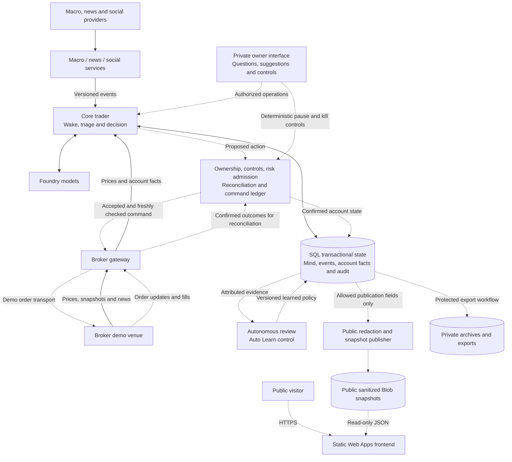
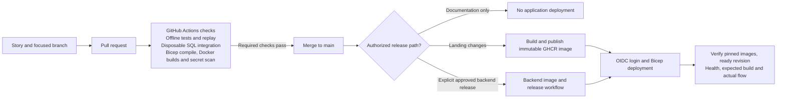

# Infrastructure diagrams

These diagrams explain PipMind using **generic service labels**. They contain no
instance resource names, hostnames, account identifiers or secret values. They
describe the recorded deployment and repository design as of **2026-10-22**;
they are not a live health check. Follow the arrows for data or control flow.

Read [workflow diagrams](workflow-diagrams.md) for what happens over time.

## 1. Hosted shadow layout

The public landing and private backend are separate Container Apps. The backend
groups the core and three feed workers in one container, with the broker gateway
in another. Logical services do not each require their own Azure resource.

```mermaid
flowchart TB
  visitor[Public visitor]
  owner[Authorized owner operations]
  macro[FXMacroData API and SSE]
  calendar[ForexFactory calendar]
  news[RSS and Atom publishers]
  social[X read-only API and role sources]
  broker[FOREX.com demo APIs and Lightstreamer]

  subgraph azure[Dedicated Azure workload scope]
    subgraph env[Container Apps managed environment - default networking]
      landing[Public landing app<br/>HTTPS, page and assets<br/>One container - zero to one replicas]
      subgraph backend[Private shadow app - exactly one always-on replica]
        subgraph engine[Engine container - 0.25 vCPU / 0.5 GiB]
          workers[Independent macro, news and social workers]
          delivery[Durable feed delivery]
          core[Shadow core and Agent Framework loop]
          api[Authenticated internal API<br/>Status and input handoff]
        end
        gateway[Gateway container - 0.25 vCPU / 0.5 GiB<br/>Demo broker reads only]
      end
      secrets[Built-in app secrets<br/>Scoped container configuration]
    end
    sql[(Azure SQL Database Standard S0<br/>Mind, journal, feed inbox and outbox<br/>Cursors, inputs, audit and retrieval)]
    foundry[Microsoft Foundry resource and project<br/>Triage and decision model deployments]
    identity[Backend managed identity<br/>Shared by the two backend containers]
    logs[Log Analytics / essential monitoring]
    backups[SQL managed backups]
  end
  analytics[Google Analytics]

  visitor -->|HTTPS| landing
  visitor -->|Browser analytics events| analytics
  owner -->|Private authenticated operations| api
  api --> core
  macro -->|Release data| workers
  calendar -->|Schedule and consensus| workers
  news -->|Headlines and analysis| workers
  social -->|Selected post and role reads| workers
  workers -->|Persist accepted events| sql
  sql -->|Pending feed outbox| delivery
  delivery -->|Accept inputs and checkpoint| core
  core <-->|TLS - durable state and evidence| sql
  core <-->|Project-backed model requests and responses| foundry
  gateway <-->|Login, streaming and REST reads| broker
  gateway -->|Authenticated local state - prices and snapshots| core
  gateway -->|Headline relay| workers
  secrets -.->|Provider and internal API configuration| engine
  secrets -.->|Broker and internal API configuration| gateway
  identity -.->|SQL authentication and permissions| sql
  identity -.->|Project-scoped inference access| foundry
  engine -->|Sanitized diagnostics| logs
  gateway -->|Sanitized diagnostics| logs
  landing -->|Application diagnostics| logs
  sql -->|Platform backup lifecycle| backups
```

Solid arrows show runtime data/control connections. Dotted arrows show identity
or configuration relationships. Request/response links may carry traffic in
both directions even when an arrow emphasizes the delivered data.

The landing has no connection to the private mind, model or broker. Its analytics
runs in the visitor's browser. The shadow backend records decisions and unsent
proposals; it has no order transport. Broker reads require the explicitly enabled
demo read-only profile and private configuration. A configured adapter does not
prove current provider health or complete source coverage.

The backend has internal ingress; it is not an owner-facing public web app.
Co-located containers communicate over internal/loopback endpoints with distinct
API tokens. They share identity, network and revision lifecycle. SQL uses TLS,
managed identity and explicit egress firewall rules. Default networking here
does not mean private endpoints or a custom VNet. Public signed-webhook routing
and a deployed owner browser interface remain separate qualification work.

## 2. Intended complete system

This is the target data flow, not a statement that these capabilities are all
deployed. Dashed connections identify paths that still require implementation,
integration or operational qualification.

The planned public record reads sanitized snapshots; visitors cannot invoke a
model or broker. Raw prices, vendor text, account snapshots and private audit
stay private. Public Blob access and private archive access are separate security
boundaries; these labels do not mandate two storage accounts. Blob publishing
uses managed identity with shared-key access disabled when deployed.

The target engine/gateway grouping fits the demo profile; production can split
services and identities through separately approved infrastructure. There is no
separate message broker, Redis cache, hosted-agent runtime or vector database in
this baseline: SQL provides durable delivery, state and search.

## 3. Source, checks and delivery

Deployment identity/configuration lives in protected GitHub configuration and
private inputs. Images contain application code, not local credentials, runtime
history or exports. A merged safety module is not automatically activated in the
hosted runtime, and passing CI is not proof of a successful release.

## Capability status

| Area | What these diagrams mean |
| --- | --- |
| Public landing | Previously deployed HTTPS app and browser analytics; separate from the future trading-record frontend. |
| Shadow engine, SQL and Foundry | Hosted foundation verified in recorded releases; complete live-day quality, coverage, cost and capacity qualification remains open. |
| Broker gateway | Read-only demo profile exists; no venue order transport. |
| M5 safety and recovery | Newer isolated dry SQL implementations and CI proofs exist, including command obligations and restricted complete checkpoints. They are not evidence of hosted activation. |
| Recovery on hosted S0 | Explicit Azure SQL identity and catalog candidates exist; actual permissions, trusted module deployment and independent authority/barriers require PIP-47 qualification. |
| Robot library and owner UI | Separate workstream; do not infer availability from design or an open PR. |
| Demo execution, autonomous review and public record | Later rollout stages; live-account trading requires its own owner decision. |

Sources: [architecture and deployment profiles](architecture.md#deployment),
[shadow runtime](shadow.md), [gateway read-only profile](gateway.md#hosted-read-only-profile-and-broker-evidence-pip-14),
[feed runtime](feeds.md), [dry safety integration](safety-integration.md),
[recovery](safety-recovery.md), [Azure SQL identity](safety-azure-identity.md),
[restricted checkpoints](safety-restricted-checkpoints.md), and
[roadmap](roadmap.md). Deployment structure is defined in
[the backend template](../infra/shadow-app.bicep) and
[the foundation template](../infra/shadow-foundation.bicep).
