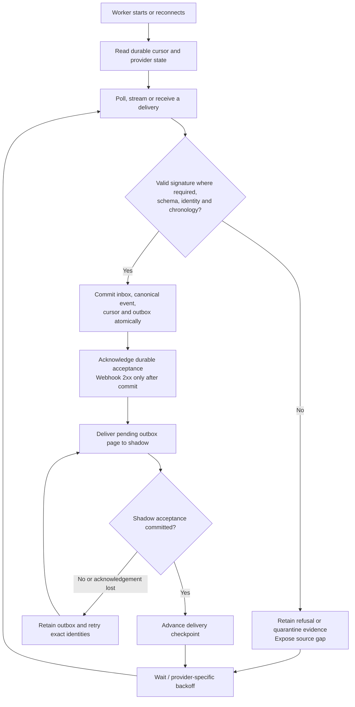
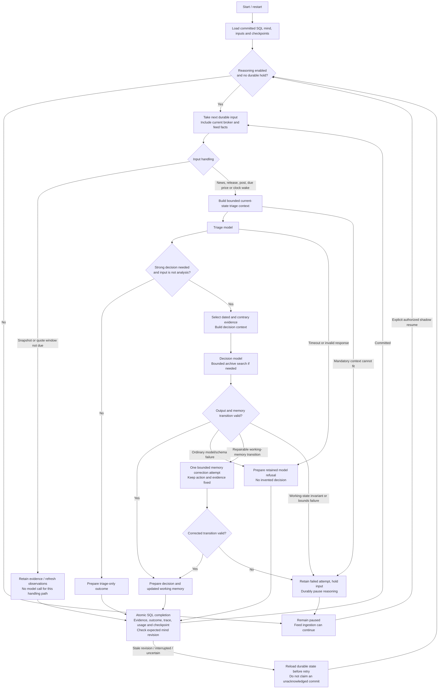
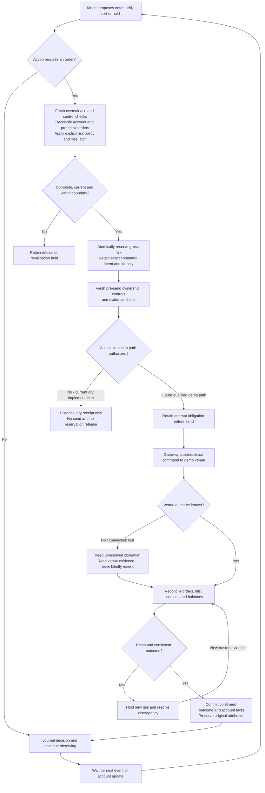
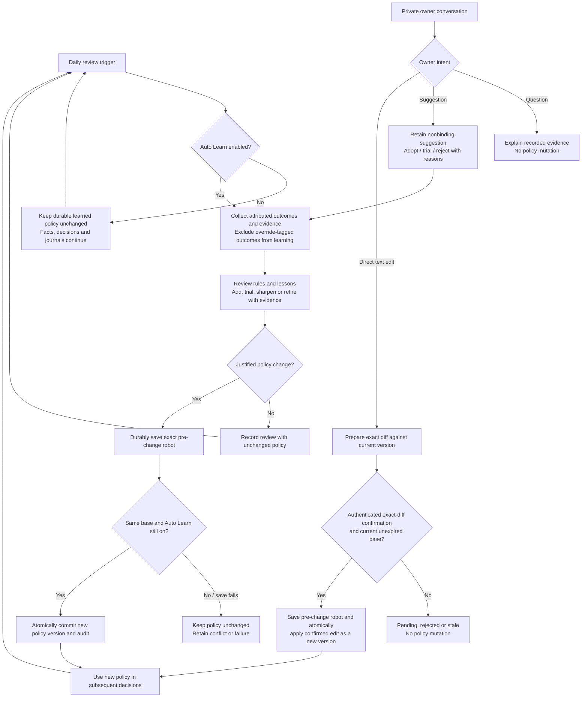
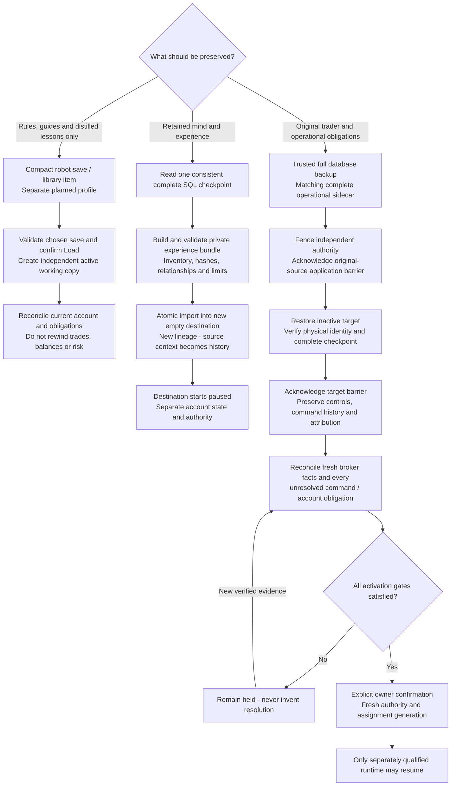
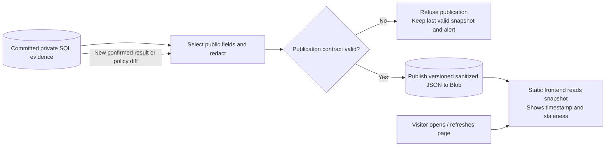

# Workflow diagrams

Read [infrastructure diagrams](infrastructure-diagrams.md) for where these steps
run. These workflows use generic labels and describe the repository contracts
as of **2026-10-22**, not live instance health. Each section states whether it is
the implemented shadow path, an isolated dry implementation, or a future path.

PipMind has several loops: provider delivery, event-driven reasoning, future
order reconciliation, future nightly learning, and operational recovery. The
end of one event's processing returns to waiting for another event; it does not
end the trader.

## 1. Provider intake and durable delivery

**Implemented foundation; live coverage and outage/backfill qualification remain
open.** The workers run independently. X access is read-only.

SQL retains accepted source facts before reasoning. Exact redelivery deduplicates;
changed facts under an existing identity refuse rather than overwrite history.
SSE reconnect uses the saved cursor. Calendar caching and provider-specific pacing
prevent a tight retry loop. Signed webhook code exists; the diagram does not
claim an approved public callback route is deployed.

## 2. Continuous shadow reasoning loop

**Implemented M4 path.** It produces journaled observations, decisions, refusals
and unsent proposals. It cannot place an order.

The mind combines identity, playbook, current views/theses/waiting conditions,
journal and searchable older evidence. Full audit stays in SQL; bounded prompt
projections do not delete history. Triage chooses whether to involve the stronger
model. Deterministic aggregation is transport/wake management, not a hidden
trading strategy. Clock inputs let the loop wake without a new headline.

SQL is not locked across a long inference call. The completion checks the mind
revision before committing, so a pause or concurrent change invalidates stale
output. A crash before completion can repeat a billable inference call but cannot
duplicate an already committed outcome. Holds need inspection and explicit
resumption; they are not automatically erased by a retry.

## 3. Proposed action to confirmed broker outcome

**Future integrated execution loop.** Isolated M5 dry safety/admission/command
code exists. It permanently denies dispatch authority. M6 demo venue transport
and its operational qualification are separate work; no current shadow arrow
enters this execution path.

Only the gateway speaks the venue protocol. The broker is authoritative for
positions and balances; an unsent proposal or dry receipt is not a fill. Exact
command identity prevents a retry from becoming a second command. The current
command journal retains unattempted/attempted/unknown obligations; terminal
resolution and reservation release must be implemented and verified before this
future loop can clear them. A new process or restored database cannot grant
itself fresh authority from an old receipt.

## 4. Autonomous learning and owner influence

**Planned learning and owner-interface behavior.** Current working-memory updates
are different from rewriting learned rules. Library/Auto Learn controls have a
separate implementation workstream; this diagram does not claim they are hosted.

Enabled autonomous review does not wait for owner approval. Confirmation applies
to the direct owner edit. A pending edit never blocks independent learning; a
learning commit can make that edit stale. Auto Learn Off must also reject stale
in-flight automatic writers. Pause/kill/flatten are separate deterministic
controls and cannot depend on a model agreeing; flatten has no execution in the
current dry implementation.

## 5. Save, clone and recovery are different workflows

**Experience export/paused clone is implemented.** Compact library saves are a
separate workstream. Recovery/handover has an isolated dry reference integration;
actual hosted S0 identity, permissions and independent authority/barriers remain
operational qualification gates.

A compact save cannot replace a complete experience archive or native database
backup. A clone cannot inherit live account authority, active source positions or
pending owner consent. Recovery cannot reset a daily-loss latch, clear an unknown
order, or reactivate an old lease. An external fence alone is not proof that an
old application transaction stopped; source and target barriers are separate.
Current dry command obligations can deliberately keep activation held because
there is no verified terminal-resolution path yet.

Exports fail if a complete checkpoint exceeds its selected format limits;
neither history nor a bundle is silently truncated. Private bundles stay outside
source, images and public snapshots. See [experience bundles](shadow.md#experience-bundles-and-cloning),
[recovery](safety-recovery.md) and [complete command checkpoints](safety-command-recovery.md).

## 6. Public record publication and visitor reads

**Planned M8 path.** The deployed landing is informational and has no track record.

Publish the account's own confirmed fills, P&L, recorded rationale, public
playbook diffs and override labels after the required rights/redaction checks.
Raw quotes, vendor feeds, secrets, account snapshots and private audit remain
private. Visitor reads do not trigger reasoning or brokerage. Publication failure
must not manufacture a result or hide the age of the last successful snapshot.

## Reading the loops together

1. Providers keep delivering and SQL retains accepted inputs independently.
2. The shadow core consumes inputs, reasons where needed and persists outcomes;
   the next input sees the newly committed mind.
3. A future qualified execution path closes its loop with confirmed broker facts.
4. A future enabled review loop updates learned policy for subsequent decisions.
5. Save/clone/recovery are explicit operations with different account semantics.
6. A future publisher exposes a sanitized record independently of visitor traffic.

Detailed contracts: [feeds](feeds.md), [shadow](shadow.md),
[gateway](gateway.md), [dry safety integration](safety-integration.md),
[command journal](safety-command-journal.md),
[owner chat](architecture.md#private-owner-chat-and-confirmed-edits),
[Auto Learn](architecture.md#auto-learn-and-exact-saved-mind), and
[rollout order](roadmap.md).
